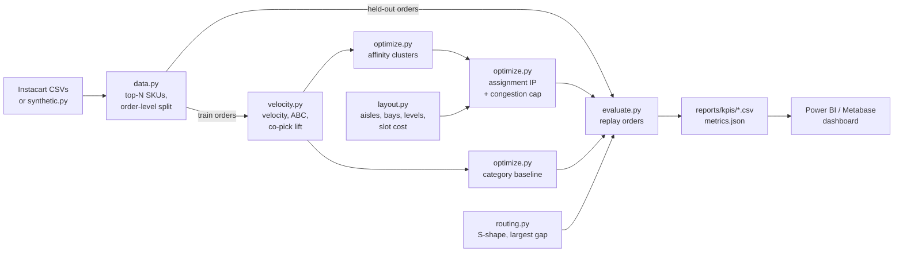

# Dark-Store Slotting & Pick-Path Optimisation

**Python (pandas, PuLP + HiGHS), SQL-style aggregation, Power BI-ready KPI exports**

Where a SKU sits in a quick-commerce dark store decides how far a picker walks for every
order. This project takes order history, decides where each SKU should be slotted, and
replays held-out orders to measure walk distance and pick time against a category-wise
layout.

1. **Demand profile**: SKU velocity, ABC classes on cumulative pick share, and pairwise
   **co-pick affinity** (count and lift) from order lines.
2. **Slotting model**: affinity clustering groups SKUs that are bought together into
   bay-sized clusters. An **integer program** (PuLP, HiGHS solver) then assigns clusters to bays,
   minimising picks x slot cost under a **per-aisle congestion cap**. Inside each bay, the
   fastest SKUs take the golden-zone shelves (levels 2-3).
3. **Pick-path simulation**: held-out orders are routed with **S-shape** and **largest-gap**
   heuristics on a grid model of the store to give walk metres and pick seconds per order.
4. **KPI exports**: CSVs for a Power BI / Metabase dashboard covering lines per hour, orders
   per hour, per-aisle pick share (congestion) and the slotting plan itself.
5. **Pilot plan**: [`docs/pilot_plan.md`](docs/pilot_plan.md) explains how to trial the new
   layout zone by zone in a live store, with go/no-go KPIs.

> **Status.** This is the working architecture. The full pipeline and tests run end to end on
> synthetic Instacart-shaped data. On 20,000 synthetic orders (2,000 SKUs, 9 aisles) the
> optimised layout cuts mean walk distance by about **42% (S-shape) / 33% (largest gap)** and
> pick time by about **28% / 20%** compared with the category layout. Results on the real
> Instacart data are written to `reports/metrics.json` at run time.

## Architecture



## Setup

```bash
python -m venv .venv && source .venv/bin/activate   # Windows: .venv\Scripts\activate
pip install -r requirements.txt
pip install -e .
```

**Data.** Download the *Instacart Market Basket Analysis* files from Kaggle and place
`orders.csv`, `order_products__prior.csv` and `products.csv` in `data/raw/` (git-ignored).

## How to run

```bash
# Real data (first 300K orders, top 2,000 SKUs by default)
python -m slotting.pipeline --config configs/config.yaml

# Smoke run on synthetic orders
python -m slotting.pipeline --synthetic 20000 --output-dir reports/synthetic_smoke

# Tests
pytest -q
```

Outputs under `--output-dir`:

| File | Use |
|---|---|
| `metrics.json` | walk / pick-time reduction per routing heuristic |
| `kpis/sku_velocity_abc.csv` | velocity and ABC class per SKU |
| `kpis/top_affinity_pairs.csv` | strongest co-pick pairs |
| `kpis/slotting_plan_{baseline,optimised}.csv` | SKU to aisle / bay / level / slot |
| `kpis/orders_{plan}_{routing}.csv` | per-order lines, walk metres, pick seconds |
| `kpis/zone_congestion_{plan}.csv` | share of picks per aisle |

## Project structure

```
dark-store-slotting/
├── configs/config.yaml      # layout, ABC thresholds, solver and picking parameters
├── data/raw/                # Instacart CSVs (git-ignored)
├── docs/pilot_plan.md       # zone-by-zone rollout with go/no-go KPIs
├── src/slotting/
│   ├── data.py              # load, top-N SKUs, order-level train/hold-out split
│   ├── synthetic.py         # Instacart-shaped synthetic orders
│   ├── velocity.py          # velocity, ABC, co-pick affinity and lift
│   ├── layout.py            # grid model of aisles, bays, levels, slot cost
│   ├── optimize.py          # affinity clustering, assignment IP, category baseline
│   ├── routing.py           # S-shape and largest-gap route length
│   ├── evaluate.py          # order replay and picking KPIs
│   └── pipeline.py          # CLI entry point
└── tests/test_slotting.py
```

## Modelling notes

- **Why decompose.** A full SKU-to-slot model with co-pick terms is a quadratic assignment
  problem, which is intractable for 2,000 SKUs. Clustering first keeps the IP to about
  100 clusters x 200 bays, which HiGHS solves in seconds.
- **Slot cost.** Bays are costed aisle by aisle (within-aisle storage). With traversal
  routing, the number of aisles entered dominates walk distance, so fast movers belong in
  the fewest, nearest aisles. Costing bays by straight-line distance to the pack station
  instead spreads A items across the front of every aisle, which is *worse* under S-shape
  routing.
- **Congestion cap.** Without a cap every A item lands in aisle 1 and pickers queue there.
  The cap limits any aisle's share of total picks, and it is never set below an even split.
- **Fair baseline.** The store is sized to the SKU range so both layouts use the same aisles.
  A dark store is full, and an oversized store would flatter whichever layout is more compact.
- **Pick time** = walk distance / walk speed + seconds per line + seconds per order, all set
  in `config.yaml`. Calibrate them with a time-and-motion study in the store before trusting
  the absolute numbers.

## License

MIT © Mayank Sharma
